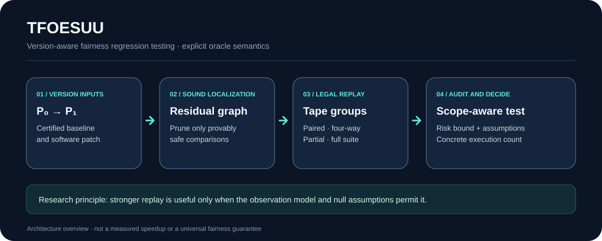

# TFOESUU

**Testing Fairness of Evolving Software under Uncertainty**

[](LICENSE)
[](pyproject.toml)
[](docs/PROOF_STATUS.md)

**A reproducible Python research toolkit for analyzing the execution cost of fairness-regression testing in evolving stochastic software.**



## Why this project exists

When a stochastic program is patched, rechecking every fairness obligation from scratch can be expensive. TFOESUU studies when a previously certified version, sound change information, and *legal* shared-randomness replay can reduce the number of executions needed to detect a fairness regression.

The framework separates **mathematical oracle calls, replay rounds, concrete program executions, and wall-clock measurements**. It does not claim that every system is seedable or that statistical fairness is equivalent to causal fairness.

## Capabilities

| Module | Purpose |
| --- | --- |
| `certificate.py`, `planner.py` | Prune obligations only with sound impact/effect guarantees; select scope-matched tests |
| `allocation.py`, `graphs.py` | Gaussian graph-allocation geometry and benchmark graph families |
| `oracles.py`, `testers.py` | Explicit old/new observation contracts and statistical tests |
| `control_replay.py`, `partial_replay.py` | Restricted replay topology, control access, and fractional covers |
| `suite_replay.py`, `separations.py` | Full-suite and paired/four-way replay models |
| `preview_results.py`, `public_fairlearn_v2_results.py` | Fail-closed experiment admission and historical software-subject checks |

**Scope matters:** most formal guarantees apply only to declared Gaussian or common-uniform threshold families. Unrestricted heterogeneous composite-nuisance optimality is not established. See [proof status](docs/PROOF_STATUS.md) and [theorem-to-algorithm mapping](docs/THEOREM_ALGORITHM_MATRIX.md).

## Quick start

Requires Python **3.10 or later**. Install into an isolated environment:

```bash
python -m venv .venv
# Linux/macOS: source .venv/bin/activate
# Windows PowerShell: .venv\Scripts\Activate.ps1
python -m pip install -r requirements-dev.txt
python -m pip install -e .
python -m pytest -q
```

For a small, reproducible CPU demonstration:

```bash
python experiments/run_gaussian_core.py --graph star --n 8 --trials 500 --gamma 0.7 --beta 0.05
python experiments/run_replay_separation.py --p 0.5 --d 0.05 --beta 0.05 --trials 1000
```

The demonstration uses synthetic oracle models; its output is **not** an evaluation of discrimination in real populations. The test suite may need additional dependencies for optional historical-subject checks.

## Repository organization

```text
src/tfoesuu/       Core algorithms, formal observation interfaces, and validation
experiments/       Bounded scientific experiments and geometry sanity checks
data/              Small frozen specifications and admitted aggregate evidence
tests/             Scope, regression, adversarial, and numerical tests
scripts/           Deterministic data generation and reproducibility utilities
configs/           Explicit experiment protocols
external_subjects/ Version-pinned external software integration
docs/              Technical documentation, proofs, and research audit records
```

Scientific result files are governed by [reproducibility documentation](docs/REPRODUCIBILITY.md). Avoid editing frozen result rows or copying theoretical rates into empirical tables. Large benchmarks and optional CUDA dependencies are intentionally separated from the default CPU environment.

## Reproducibility and security

Use [the contribution guide](CONTRIBUTING.md) for tests and provenance; [security policy](SECURITY.md) for responsible disclosure; [data documentation](data/README.md) for dataset sources and restrictions. Public benchmark inputs and third-party packages may carry licenses that differ from this project's MIT license.

GitHub Actions status must be checked on GitHub; a configured workflow or a local passing suite does not mean hosted checks have executed successfully.

## License and citation

Original project code and documentation: [MIT License](LICENSE), **subject to contributor rights and third-party notices** in [THIRD_PARTY_NOTICES.md](THIRD_PARTY_NOTICES.md). Historical datasets, upstream software, and imported publisher templates are not relicensed.

Citation metadata is in [CITATION.cff](CITATION.cff). This repository is research software; it does not imply peer-reviewed acceptance or provide a paper download.

## Scientific limits

The project does not certify fairness in arbitrary deployed software, establish causal discrimination estimates, or automatically validate soundness of third-party static impact analyses. Methods must be used only with their documented oracle, null, margin, and cost assumptions.
